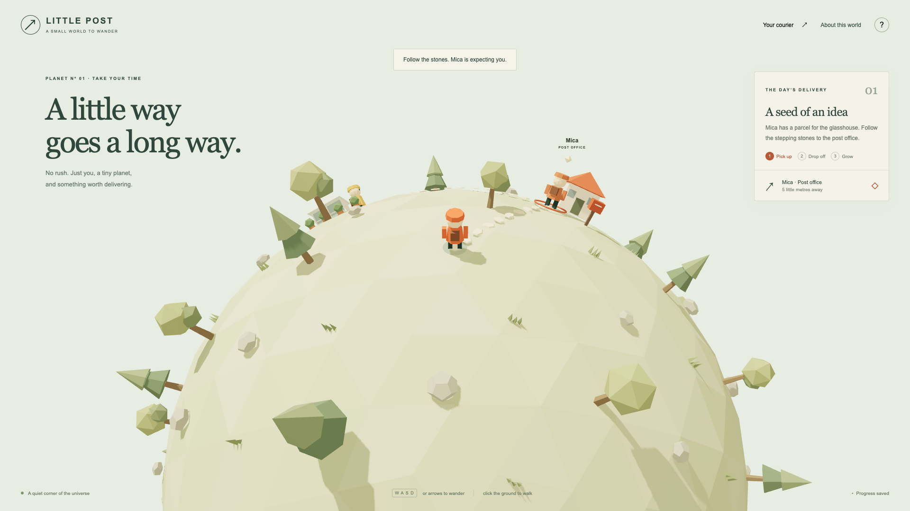
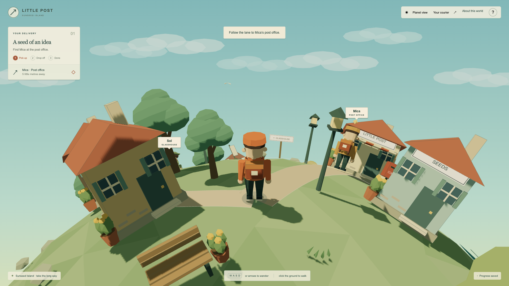
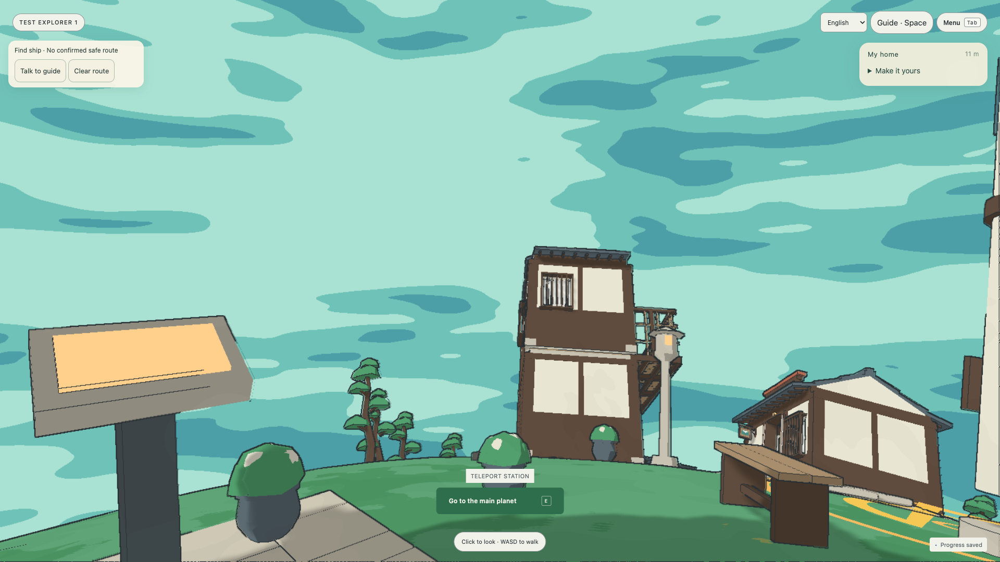
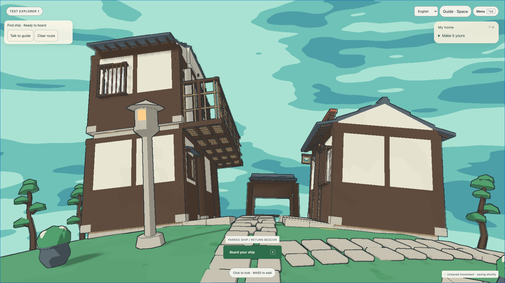

# Little Worlds PROCESS

*AI assistance note: AI helped reorganise and paraphrase my own account against repository evidence. Personal play, classmates’ feedback and agent-run checks are distinguished below.*

## From a reference to a different purpose

The agents' first ideas seemed too simple, so I asked them to investigate comparable creative work and explored [Messenger](https://messenger.abeto.co/) myself. On 4 October I agreed to start with a courier prototype. When the agent reported a playable version, I said it remained far from the reference; their [reference comparison](docs/evidence/round-2/reference-observation.md) then focused the next iteration on a closer character, denser surroundings and less intrusive UI.

*Captures from [e1e1d54](https://github.com/comp4020-agentic-coding-studio/comp4020-final-ray0766/commit/e1e1d54) show the move towards the reference's scale and density.*

The reference helped communicate appearance, but I wanted more than delivering parcels: each player should have a planet to build on, which visitors could explore but not alter. In [733c543](https://github.com/comp4020-agentic-coding-studio/comp4020-final-ray0766/commit/733c543) that direction reached CLAUDE.md, server ownership rules and tests for competing claims, visitor writes and saved worlds. The agents designed those mechanisms; I supplied the boundary they had to protect.

## Giving the agents a shared direction

I asked for a more convincing industrial harbour and equally good resources for players' buildings. I used GPT and Claude as second opinions on each other's proposals: GPT proposed visual directions, Claude checked limited parts, and I chose the direction. [103a7ff](https://github.com/comp4020-agentic-coding-studio/comp4020-final-ray0766/commit/103a7ff) records one division between the asset layer and Claude's editor/assembly work. A workshop demonstration still needed integration with editing, ownership and saving, so for Crit 8 I prioritised a working release over importing everything.

The first prototype ([c02a639](https://github.com/comp4020-agentic-coding-studio/comp4020-final-ray0766/commit/c02a639e8dbcba3c06aa0faa812560b55442ba64)) arrived as TypeScript, Three.js, Vite, native DOM and Node 24 with built-in SQLite, and I kept that stack throughout. Its trade-offs were custom spherical interaction without a full engine, fewer UI dependencies and transactional saves without native add-ons, at the cost of managing focus ourselves and requiring Node 24. Sharing uses plain HTTP: the client polls world state every second and sends presence heartbeats every 250 ms; revision and sequence numbers fence stale replies. I accepted polling over WebSockets because the agents' Crit 9 measurements traced the delay other players felt to CPU-heavy home preparation on one 256 MB machine, not to transport; a bounded worker was the real repair ([ADR 0008](docs/adr/0008-multiplayer-preparation.md)).

The larger district then lost the small-world feeling I wanted, so I asked to cut empty travel and return to compact planets while keeping the new village resources and saved layouts ([c7fe9dd](https://github.com/comp4020-agentic-coding-studio/comp4020-final-ray0766/commit/c7fe9dd)): better assets did not mean keeping the larger scale.

## Letting play change the plan

On 12 October, confusing teleport explanations led me to simplify travel to the main planet and one's own home ([d725b96](https://github.com/comp4020-agentic-coding-studio/comp4020-final-ray0766/commit/d725b96)). During Crit 9, approaching walls could swing the camera skyward. I requested changes, tried them and found some worse. I chose the earlier camera, retained its indoor switch temporarily, and narrowed the next repair to the upward swing, then asked for the technical checks and a handover for my own play. The camera audit ([6a1142d](https://github.com/comp4020-agentic-coding-studio/comp4020-final-ray0766/commit/6a1142d)) records the restored implementation and the remaining differences.

## Reducing interruptions and control demands

For Crit 10, I asked the agents to check the submission requirements rather than assume readiness: identity and permission boundaries, action logging and loading guidance ([7d48d2b](https://github.com/comp4020-agentic-coding-studio/comp4020-final-ray0766/commit/7d48d2b)). I approved a device notice and watched classmates play normally; useful feedback, not comprehensive acceptance. My own flight testing then exposed repeated loading interruptions, and I explicitly accepted a longer initial wait in exchange for fewer interruptions during travel.

The agents introduced bounded preparation and reuse: on their [controlled intermediate route](docs/evidence/final-hd/historical-flight-loading.json), blocking waits fell from 18 to zero while initial readiness rose from 5.85 to 7.70 seconds, the trade-off I had asked for, measured on one route, not every device. I also requested a Messenger-like welcome on our own planet, kept the device notice, chose English as default and replaced the indoor view switch with consistent 2.5D rooms.

Fewer interruptions did not make flying easy. I had used Palworld to describe mouse-following observation, then rejected successive ship controls after playing them. High views, planar movement and a rail network still left too much driving to manage. I eventually chose destination selection with automatic takeoff, travel and landing, removed visible rails and kept free observation; selecting another planet now asks before changing destination ([9fe0aa4](https://github.com/comp4020-agentic-coding-studio/comp4020-final-ray0766/commit/9fe0aa4)).

## Making the growing world easier to enter

The same simplification continued on foot: when jumping onto an object trapped my character again, I required jumping removed, so walking and recovery had to stay usable without it.

The guide evolved alongside travel. I had requested it so newcomers could discover everything quickly; I later changed it from leading the player to standing nearby and showing a ground route. After finding another player's gate unusable, I extended return gates to visitors without granting editing rights. A lightweight original sample led to limited appearance editing; I then removed the old courier option and made character creation mandatory on first entry. I separated guide, menu and mouse controls and moved Find ship into the guide. Fixed help needs no AI; the [paid trial](docs/integration/production-guide-20261027.md) was initially local and bounded. The [integration record](docs/integration/final-local-readiness.md) consolidates these changes.

## Changing what would count as finished

I then directed three independent agents to explore and build concurrently, with their results documented and their test data retained. These were agent-operated browser sessions, not three human usability participants.

Their [26 October report](docs/evidence/three-player-20261026/README.md) showed saved construction, but also a failed Find ship route, narrow-screen obstruction and excessive sky. I requested repairs; when full checks timed out, reproducing the failures on the baseline did not satisfy my release condition, and I required the agents to investigate and fix them before publishing.

I set the release condition; the agents identified the remedies. [7115161](https://github.com/comp4020-agentic-coding-studio/comp4020-final-ray0766/commit/7115161) carries UI repairs, support-query reuse, bounded test concurrency and fixture cleanup, with rules and regressions in CLAUDE.md and the spec. No timeout or assertion was relaxed. Their [production check](docs/evidence/usability-release-20261026/README.md) reached boarding and exercised the narrow preview:

*The failed route stays in the record beside the walk that demonstrated the repair.*

The improvements are deployed and run well in my own play. The [retained-user return](docs/evidence/production-return-sync-20261027/README.md) confirmed three homes, appearances and benches after more than 34 hours across deployments, and six movement samples reached another client within 531 milliseconds. I accepted wall cutaway and same-position overlap. Looking back, my direction developed from specifying a reference to selecting interactions and requiring evidence before release.
