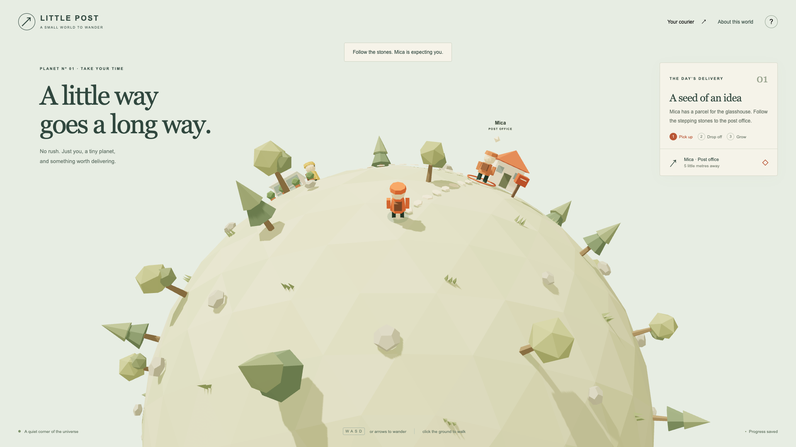
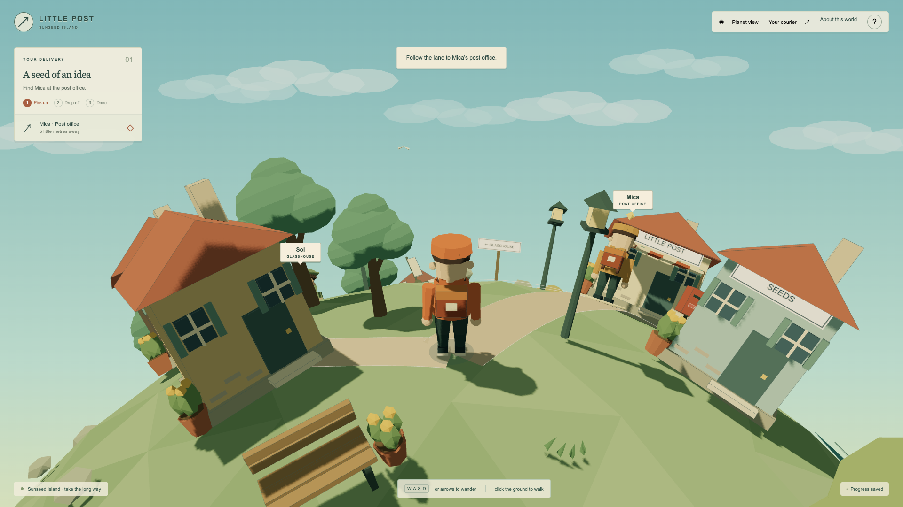
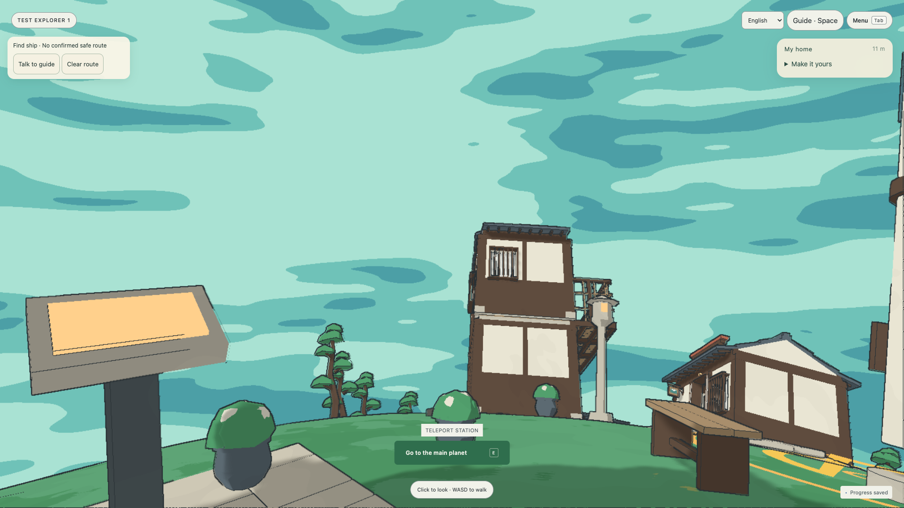
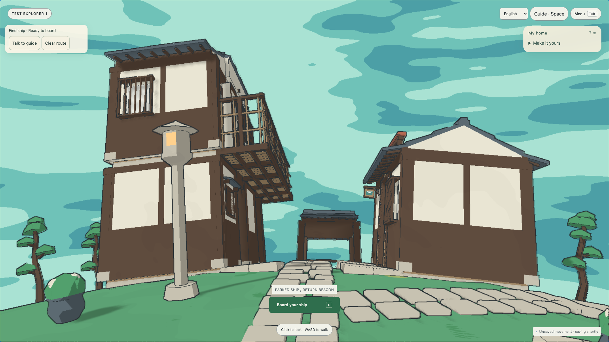

# Little Worlds PROCESS

*AI assistance note: AI helped reorganise and paraphrase my supplied account and messages against repository evidence. Personal play, classmates’ feedback and agent-run checks are distinguished below. Images show application results.*

## From a reference to a different purpose

I began by asking the agents for ideas, but their first suggestions seemed too simple. I asked them to investigate comparable creative work, then explored [Messenger](https://messenger.abeto.co/) myself. On 4 October I agreed to start with a courier prototype. When the agent reported a playable version, I said it remained far from the reference. The agents' [reference comparison](docs/evidence/round-2/reference-observation.md) then focused the next iteration on a closer character, denser surroundings and less intrusive UI.

*Early application captures in [e1e1d54](https://github.com/comp4020-agentic-coding-studio/comp4020-final-ray0766/commit/e1e1d54) show the response towards the reference's scale and density. They document implementation changes, not acceptance of every detail.*

The reference helped communicate appearance, but I wanted something beyond delivering parcels. I asked for each player to have a planet to build on, with visitors able to explore but unable to alter it. This shifted the brief towards what players could create, retain and visit. In [733c543](https://github.com/comp4020-agentic-coding-studio/comp4020-final-ray0766/commit/733c543), that direction reached CLAUDE.md, server ownership rules and tests for competing claims, visitor writes and saved worlds. The agents designed those mechanisms; I supplied the boundary they had to protect.

## Giving the agents a shared direction

As construction grew, I asked for a more convincing industrial harbour and equally good resources for players' buildings. I arranged GPT and Claude as a second opinion on proposals, rather than keeping all work in one conversation. GPT proposed visual directions, Claude checked limited parts, and I chose the direction. Their assignments changed between rounds: [103a7ff](https://github.com/comp4020-agentic-coding-studio/comp4020-final-ray0766/commit/103a7ff) records one division between the asset layer and Claude's editor/assembly work. An attractive workshop demonstration still needed integration with editing, ownership and saving. For Crit 8, I prioritised a working release over importing everything. I did not measure savings from this arrangement.

The project used TypeScript, Three.js, Vite, native DOM and Node 24 with SQLite. Its recorded tradeoffs ([c02a639](https://github.com/comp4020-agentic-coding-studio/comp4020-final-ray0766/commit/c02a639e8dbcba3c06aa0faa812560b55442ba64)) were custom spherical interaction without a full engine, fewer UI dependencies and transactional saves without native-addon compilation, at the cost of managing focus and requiring Node 24. The record does not establish who proposed the stack.

The larger district then moved away from the small-world feeling I wanted. I asked to reduce empty travel and return to compact planets while retaining the new village resources and saved layouts. [c7fe9dd](https://github.com/comp4020-agentic-coding-studio/comp4020-final-ray0766/commit/c7fe9dd) records that change: better assets did not mean keeping the larger scale.

## Letting play change the plan

As building and visits became playable, their rules needed clarification. On 12 October, confusing teleport explanations led me to simplify travel to the main planet and one's own home ([d725b96](https://github.com/comp4020-agentic-coding-studio/comp4020-final-ray0766/commit/d725b96)). Movement also exposed problems that demonstrations had missed. During Crit 9, approaching walls could swing the camera skyward. I requested changes, tried them and found some worse. I chose the earlier camera, retained its indoor switch temporarily, and narrowed the next repair to the upward swing. I then asked for the necessary technical checks and a handover for my own play. The camera audit ([6a1142d](https://github.com/comp4020-agentic-coding-studio/comp4020-final-ray0766/commit/6a1142d)) records the restored implementation and remaining differences, not independent proof of my judgement.

## Reducing interruptions and control demands

For Crit 10, I asked the agents to check the submission requirements rather than assume the project was ready. They checked identity and permission boundaries, corrected action logging and completed loading guidance, documented in [7d48d2b](https://github.com/comp4020-agentic-coding-studio/comp4020-final-ray0766/commit/7d48d2b). I approved a device notice and observed classmates playing normally; that was useful feedback, not comprehensive acceptance. Later, my flight testing exposed repeated loading interruptions. I asked for more preparation before departure and explicitly accepted a longer initial wait in exchange for fewer interruptions during travel.

The agents introduced bounded preparation and reuse. On their [controlled intermediate route](docs/evidence/final-hd/historical-flight-loading.json), blocking waits fell from 18 to zero, while initial readiness rose from 5.85 to 7.70 seconds. That matched the tradeoff I requested, without proving performance on every device. Alongside this work, I requested a Messenger-like welcome using our own planet, retained the device notice, and chose English as the default. I also replaced the indoor view switch with consistent 2.5D rooms.

Fewer interruptions did not make flying easy. I had used Palworld to describe mouse-following observation, then rejected successive ship controls after playing them. High views, planar movement and a rail network still left too much driving to manage. I eventually chose destination selection with automatic takeoff, travel and landing, removed visible rails, and retained free observation. Selecting another real planet now asks before changing destination. The integrated result is in [9fe0aa4](https://github.com/comp4020-agentic-coding-studio/comp4020-final-ray0766/commit/9fe0aa4).

## Making the growing world easier to enter

The same simplification continued on foot. During my own play, jumping onto an object trapped the character again. I reported the failure and required removal of jumping. That changed the interaction requirement: walking and recovery had to remain usable without a jump action.

The guide evolved alongside travel. Worried that newcomers could not discover everything quickly, I had requested a guide; I later changed it from leading the player to standing nearby while showing a ground route. I also extended return gates to visitors after finding another player's gate unusable, without granting editing rights. A lightweight original sample led to limited appearance editing; I then removed the old courier option and made creation mandatory on first entry. I separated guide, menu and mouse controls, and moved Find ship into the guide. Fixed help needs no AI; the [paid trial](docs/integration/production-guide-20261027.md) was initially local and bounded. These changes are consolidated in the [integration record](docs/integration/final-local-readiness.md).

## Changing what would count as finished

I then directed three independent agents to explore and build concurrently. I required their results to be documented and their test data retained. These were agent-operated browser sessions, not three human usability participants.

Their [26 October report](docs/evidence/three-player-20261026/README.md) showed saved construction, but also a failed Find ship route, narrow-screen obstruction and excessive sky. I reviewed those findings and requested repairs. When full checks timed out, reproducing failures on the baseline did not satisfy my release condition. I required the agents to investigate and fix the encountered failures before publishing, rather than treating a baseline failure as acceptance.

My release condition concerned resolving the failures; the agents identified the technical remedies. [7115161](https://github.com/comp4020-agentic-coding-studio/comp4020-final-ray0766/commit/7115161) carries UI repairs, support-query reuse, bounded test concurrency and fixture cleanup, with rules and regressions in CLAUDE.md and the spec. No timeout or assertion was relaxed. Their [production check](docs/evidence/usability-release-20261026/README.md) reached boarding and exercised the narrow preview:

*The failed route stayed in the record; the later walk demonstrated the repair. Neither image establishes universal comfort.*

Before publishing those repairs, I requested a [return with the retained users](docs/evidence/three-player-20261026/return-visit/README.md): their saves on the earlier `393b977` release survived an intervening deployment and about 13.5 hours across Sydney's date change, not 24 hours. I also requested consistency checks after publishing. I accepted wall cutaway and same-position overlap as known limits. Looking back, my direction developed from specifying a reference to choosing which interactions to retain and what evidence justified release. I have not yet completed final human acceptance.
