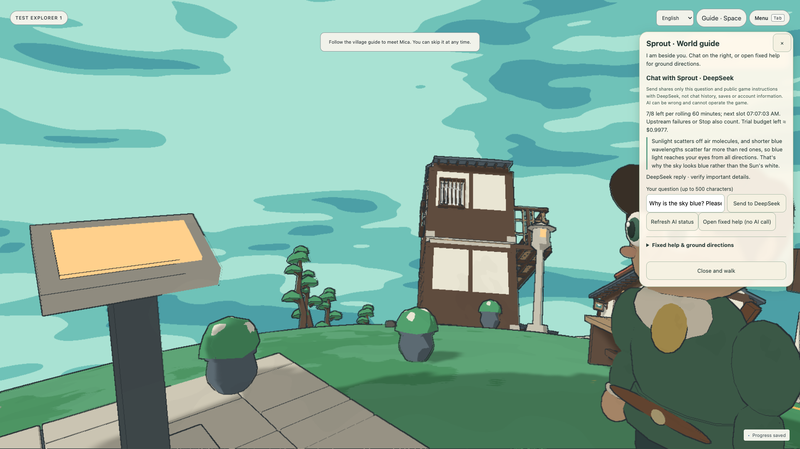
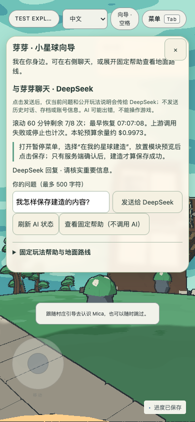

# Production guide handoff — 27 October 2026

The author explicitly approved using the existing DeepSeek credential on the existing Fly backend, retiring local paid use and transferring the **remaining original budget**, without adding another US$1 allowance. This record describes that handoff and its release gates; current service availability is reported in the guide panel.

## One budget, one active backend

At handoff there were seven completed attempts, no pending requests, US$0.0017832 conservatively charged and **US$0.9982168 remaining**. A SQLite consistent backup preserved all request records, hourly timestamps, policy and charges. Both local paid ports were inactive. The local launcher was fenced before credential loading and its ledger halted; the production copy retains the original active flag. This prevents the two supported launch paths spending the same balance. The source credential remains private; it is not an application asset.

The 20,480-byte transferred file at `/data/guide-ai/trial.sqlite` passed integrity checking and matched SHA-256 `cb68d663e885acf5c443a492ea0c95757fbb228fa8c44a7063388d46d675c1b2` before activation. Production startup requires explicit deployment mode, the expected Fly app, this exact persistent path and a pre-existing trial row. It cannot initialise an empty production budget. Runtime writes will naturally change the file; subsequent validation compares accounting and integrity rather than expecting that initial hash forever.

The original cumulative US$1 cap, eight attempts per rolling hour per server-validated cookie identity, two-request concurrency limit, 500-character question limit, 256-token output bound, no automatic retries, conservative unknown charges and deadline remain: **1 January 2027 00:00 Australia/Sydney**. Only the current submitted question and public game instructions reach the pinned official DeepSeek endpoint; no saves, account identity, prior conversation or private messages are included. Clearing cookies is not prevented; the global ledger is the backstop.

Official Flash peak pricing rechecked on 27 October remains US$0.30/million input cache-miss tokens and US$1.20/million output tokens. The unchanged ledger reserves and settles at twice those rates, US$0.0202752 per bounded reservation. This is conservative application accounting, not a guarantee of a future supplier bill or other use of the credential. Model `deepseek-flash`, non-thinking streaming; [official pricing](https://api-docs.deepseek.com/quick_start/pricing/).

## Release and validation boundaries

The credential is supplied only through Fly's encrypted secret import on standard input. It is staged without enabling requests. First deploy the checked code with AI disabled using the existing CI, production database backup and release confirmation; only then enable the controlled production configuration. This avoids making the previous local-only server fail during the code rollout. Never roll back to that older server while leaving the production enable flag on. Preserve the game database, retained test profiles/buildings and the accounting ledger through deployment or recovery.

The earlier [987-test gate and desktop/narrow mock checks](guide-chat-panel-20261027.md) concern the chat revision. The final local gate passed 155 files / 991 tests, including the additional startup/ledger cases for production fencing and refusal to create a replacement trial; typecheck, full lint, client/worker build and evidence checks also passed. Real-provider acceptance is a separate post-deployment step, within this same budget, using retained test identities and only public/fictitious questions; no model-quality or latency result is inferred from the mocks. Failure simulation remains explicitly labelled and need not consume a real provider attempt. The CI run and runtime acceptance in the release handover identify the exact deployed SHA.

The research revision has 687 body words. PROCESS and Crit 8/9/10 retain their truthful historical descriptions; production approval does not retroactively change the earlier local-only phase.

## Production acceptance

Executable revision [720ff83](https://github.com/comp4020-agentic-coding-studio/comp4020-final-ray0766/commit/720ff83b58bfdc0b381a1cd25bc1f9ae74fd5c4d) passed [CI and deployment run 40564747942](https://github.com/comp4020-agentic-coding-studio/comp4020-final-ray0766/actions/runs/40564747942): 155 files / 991 tests, evidence checks and secret scans. The production game backup was 786,432 bytes, schema 20, integrity `ok`, zero foreign-key violations; the existing integrated database needed no migration. The release was confirmed at 19:04:32 UTC. AI was enabled only after this success, through Fly configuration on that same image. Subsequent documentation commits do not change this tested executable revision.

At 19:07 UTC, retained test users 1 and 2 used the actual right-side panel in installed Chrome at 1920×1080 and touch-emulated 390×844. No new identity was created. An English question about the blue sky received a light-scattering explanation; a Chinese building-save question correctly required Save and server acknowledgement. Neither response came from fixed help. Each identity showed 7/8 remaining. Their planet names, saved appearance and current-planet objects matched before/after; no buildings were placed or removed.

| Actual provider attempt | First content at backend | Total backend stream | Browser round trip | Tokens in/out | Conservative charge |
| --- | ---: | ---: | ---: | ---: | ---: |
| English general question | 2,113 ms | 2,538 ms | 2,841 ms | 639 / 43 | US$0.0004866 |
| Chinese saving question | 622 ms | 841 ms | 1,321 ms | 600 / 28 | US$0.0004272 |

The nine-record ledger then showed **US$0.0026970 cumulative accounting**, **US$0.9973030 remaining**, no pending attempts and integrity `ok`. The two acceptance calls added US$0.0009138; no budget was reset. These are conservative token-rate charges, not a provider invoice or latency guarantee. Local paid startup remains disabled.

An initial browser attempt selected the hidden welcome-language control and stopped **before sending**; the unchanged seven-record ledger confirmed zero charge. The corrected attempt selected the visible control. Chrome response-body capture failed after both real streams, so answer content was verified in the rendered UI/screenshots and token/timing results were read from the two ledger entries, not invented from a missing capture. The failure UI was checked with a browser-injected HTTP 503: it retained input and displayed failure without a fixed answer. That check made no provider request and is not described as a real provider outage.

Only synthetic test questions and visible gameplay are included. Raw browser profiles, cookies, credentials, request records and databases remain private. Real replies do not establish universal factual accuracy; mock quota/exhaustion tests remain distinct from the two real acceptance calls.
