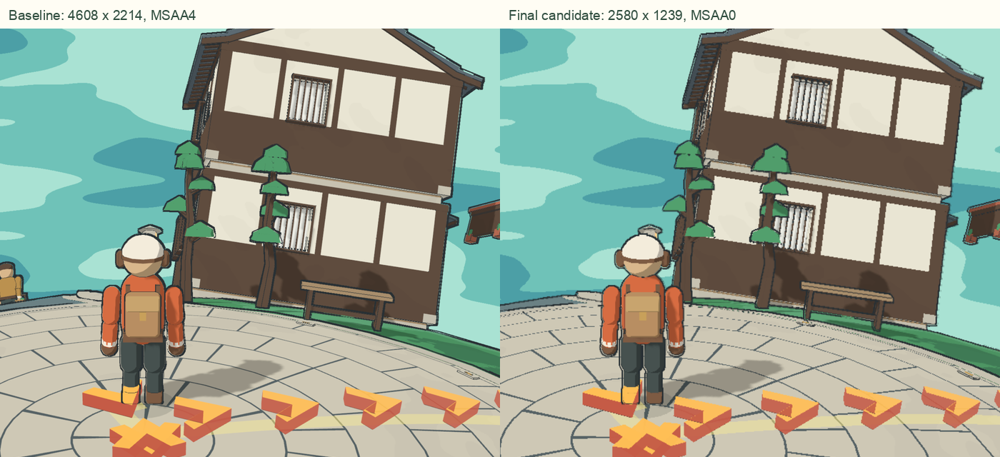

# Retina 大窗口性能候选 · 2026-10-18

代码提交 `a443c5e`，基线 `5ed138d`。这是供用户体验的本地候选；现用8098仍运行冻结基线，尚未替换、推送或部署。未更改服务器、数据库、镜头、物理或存档权限。

## 问题与改动

此前只限制DPR。在CSS2560×1230、DPR2下，Beautiful仍分配4608×2214（约10.2MP）的画面，再使用两个默认4倍MSAA的半浮点离屏目标。小窗口/DPR1验证没有覆盖这一负载，旧验收不能证明Retina流畅。

`quality.ts`同时限制像素总量：实际ratio取DPR上限与 `sqrt(像素预算/(CSS宽×高))` 的较小值。只缩放3D画布，DOM文字与控件不变。

| 档位 | DPR上限 | 像素预算 | 阴影贴图 | 村庄描线 |
| --- | ---: | ---: | ---: | --- |
| Smooth | 1 | 1.5MP | 关闭 | 关闭 |
| Standard | 1.35 | 1.5MP | 1024 | 保留 |
| Beautiful | 1.8 | 3.2MP | 2048 | 保留 |

`village-drawing.ts`在宿主新建composer后、首次分配真实尺寸前，把两个离屏目标的samples设为0。厂商资源保持字节不变，现有四子采样描线算法保留。关闭MSAA会减少部分几何边缘的抗锯齿；像素预算会降低大窗口3D锐度。中英文设置已说明大窗口的响应/锐度取舍，自动档仍从Standard开始，手动选择不会被自动测量覆盖。

初步候选Beautiful使用2MP（2040×980），在用户CSS尺寸查看时窗棂、斜边显得粗糙，因此最终提高到3.2MP（2580×1239），约为一个世界像素对应一个CSS像素。390×844窄窗口仍可用1.8倍密度（702×1519）。最终画面可读，描线与阴影保留，但斜线和细节仍比原版粗，不能称为无损。用户实际窗口的画质和流畅度仍需验收。



## 可比实测

硬件为Apple M3、10核GPU、16GB，外接5K屏幕的UI分辨率2560×1440@144Hz。使用Chrome155 headless、实际ANGLE Metal Apple M3，CSS2560×1230、DPR2。独立测试身份、相同已保存位置/朝向，姿态摘要哈希一致；两版本均495drawcalls。NPC空闲动画可能改变少量三角形。用户Chrome未被操控以制造负载，外部系统负载没有完全控制。

每次只运行一个自有测试浏览器，渲染不与测试/构建并行。每次加载后预热3.5秒，无查询正常采样4.5秒；另做2.2秒同步交叉检查和1.8秒compositor trace。时间为中位数/p95，短样本不证明长时间或所有场景表现。

| Beautiful，同一视角 | 冻结基线5ed138d | 最终候选a443c5e |
| --- | ---: | ---: |
| 实际buffer | 4608×2214 | 2580×1239 |
| 无查询回调吞吐 | 19.61次/秒 | 60.00次/秒 |
| rAF间隔 | 50.0/66.7ms | 16.7/16.7ms |
| 主回调CPU提交 | 4.3/4.9ms | 2.1/2.8ms |
| 同帧同步GPU查询 | 45.76/48.74ms（12条） | 8.89/11.50ms（44条） |
| CPU至读回完成整帧 | 53.4/68.6ms | 13.1/16.5ms |
| trace已完成buffer swap | 19.80次/秒（35次） | 60.04次/秒（108次） |
| swap间隔 | 50.46/52.85ms | 16.68/17.37ms |

这证明当前受控条件下候选的headless compositor能完成约60次画面交换/秒。**不证明用户物理屏幕144Hz，也不保证多开3D窗口、热降频或其他场景仍达到同一水平。** Auto保留保守默认和慢帧降档，手动Beautiful保留用户选择。

### 为什么不用GPU查询直接换算帧率

使用当前画布的 `EXT_disjoint_timer_query_webgl2`，不创建额外WebGL上下文。驱动将查询绑定frame id和采样epoch，丢弃跨采样晚到结果，检查disjoint并保存可用延迟。无查询回调吞吐独立测量，避免把查询读数当CPU提交时间。

异步查询在高负载基线曾报约87ms，但交换吞吐约21次/秒；旧Standard的38ms查询配16.7ms回调也不能直接称60fps。查询elapsed会受到异步命令调度/排队条件影响，不能用 `1000/elapsed` 宣称真实帧率。`gl.finish()`在此实现几乎立即返回，未将它当可靠完成屏障。改在同一主回调 `endQuery` 后读取1像素，以阻塞读回交叉验证同帧GPU结果与CPU墙钟完成时间，再用独立compositor完成交换事件核对。同步读回带来额外开销，仅用于诊断，未进入产品。

## 消融与早期实验边界

- 2MP候选同条件消融：完整描线+阴影GPU查询5.31/5.98ms；仅关闭描线4.47/6.11ms；仅关闭阴影4.91/5.90ms，均约60次回调/秒。差值小且p95有噪声，没有据此删除画风或盲改阴影更新逻辑。上述消融数值属于2MP，不能冒充最终3.2MP实测。
- 初次高负载环境中，基线Beautiful曾测到GPU elapsed305ms、候选2MP约54ms。后续缓存复核时用户Chrome已无原游戏窗口，系统负载条件改变；初候选采样还与定向测试启动重叠。这些历史值留存，但不与最终同条件数据混用，也不证明清缓存有效。
- 最早一次DPR1覆盖没有触发resize，实际buffer未缩小，该次无效。后续检查明确读取真实buffer并触发resize。
- 首个名为 `diagnostic-no-msaa` 的实验因构建路径错误实际重复基线；已标记 `NOT-A-MSAA-VARIANT.json`，不作为MSAA消融。真正 `diagnostic-msaa0-actual` 才证明关闭离屏MSAA和减少像素均能降低负载。
- 引导箭头隐藏后高负载基线仍慢；当时后台家园已准备完成。因此不能把持续低帧率全归因于箭头或一次性加载。首次shader编译耗时尚未单独隔离。

## 定向验证与证据

最终预算调整后，4文件20测试通过：`quality`、`quality-drawing-lifecycle`、`village-drawing`、`welcome`。类型检查、修改文件eslint、`git diff --check`通过；纯产品客户端构建317模块通过，保留原有大chunk提示。没有重复运行全套测试。最终测试命令：

```sh
APP_URL=http://127.0.0.1:8137 EXPECT_WORLD_PROFILE=integrated node node_modules/vitest/vitest.mjs run --project app spec/quality.test.ts spec/quality-drawing-lifecycle.test.ts spec/village-drawing.test.ts spec/welcome.test.ts
```

测试启动曾遇Vite临时缓存目录写入受限，随后正常权限运行又因遗漏APP_URL而等待未启动的8080；两次为工具/命令配置失败，未算通过。补充隔离8137和profile握手后20项通过。

最终纯构建的独立Chrome检查通过：Standard→Beautiful→Smooth→Beautiful重建，自动档恢复Standard，2560×1230→1440×900→390×844→原尺寸缩放，真实键盘走动/安全路线、Atlas打开关闭，中英文说明及手动选项保持，保存位置与手动画质刷新恢复。没有空白画布、页面错误、console error或失败API。窄窗口是电脑浏览器缩放，未验证实体手机或完整触摸流程。

纯产物已检查不含 `perfNoLines`、`perfNoShadows`、`__controlled`、`__gpuPerf`，诊断注入没有进入源码或最终构建。资源目录未修改。

可提交证据在 [`../evidence/final-optimization/retina-20261018/`](../evidence/final-optimization/retina-20261018/)：摘要JSON、功能摘要、原始文件校验清单、最终画面、按CSS尺寸显示的局部对比。原始GPU行/trace/全尺寸图片保留在忽略目录 `.data/retina-performance/20261018T041510Z/` 的 `final-baseline-matched`、`final-candidate-3mp`、`pure-smoke-final`；cookie、SQLite和私有storageState未提交。

## 本地体验与恢复

独立入口：<http://retina-candidate.localhost:8137/>。主机名已用Chrome验证，使用独立测试数据库和独立浏览器身份作用域。请使用此入口体验，8098仍是原版。该服务只监听本机；未代用户打开游戏窗口。不要用同一普通Chrome访问127.0.0.1:8137替代此主机名，因为Cookie不按端口隔离。

8137由本轮隔离服务运行，runtime/dist指向 `candidate-pure/dist`，不含诊断插件。8098仍指向 `.data/midpoint/releases/1792296375954-5ed138d/dist`，未重启。恢复基线5ed138d、原冻结静态发布、已有验证bundle和 `RESTORE.zh-CN.md` 均保留；原完成tag未移动。恢复客户端不需要回退数据库。

缓存清理另行受macOS辅助访问拒绝阻塞，最后错误为-25211，未改类别或执行删除；已交回用户手动处理，本轮不再尝试。该阻塞不影响上述代码和独立浏览器验证。
